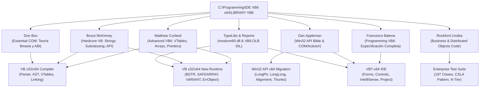

# Biblioteca de Ingeniería y Acceso Rápido: VB6 / COM / Win32 x64

> **Repositorio Oficial de Referencia Técnica y Base de Conocimiento**  
> **Ubicación:** `C:\Programming\IDE VB6 x64\LIBRARY VB6`  
> **Destino:** VB x32/x64 Compiler | VB7-x64 IDE | VB x32/x64 New Runtime | Win32 API x64 Migration  

---

## 1. Visión General del Ecosistema y Contenido

Esta biblioteca recopila los textos canónicos, las bibliotecas de tipos (TypeLibs), los reportes de descompilación COM, los catálogos del runtime (`msvbvm60.dll`) y más de 400 archivos de código fuente de arquitectura empresarial de Visual Basic 6.0.





### Métricas del Repositorio Indexado:

- **Libros y Volúmenes de Referencia:** 10

- **Total Páginas Documentadas:** 7,712

- **Componentes Runtime (`msvbvm60.dll`):** 29 módulos/interfaces y 14 enumeraciones clave

- **Controles e Interfaces GUI (`VB6.OLB`):** 98 CoClasses e Interfaces nativas

- **Archivos de Código Fuente Empresarial (Lhotka):** 418 archivos (197 clases `.cls`, 51 formularios `.frm`, 41 módulos `.bas`, 59 proyectos `.vbp`)


---

## 2. Catálogo Maestro de Libros y Documentos


| ID | Libro / Documento | Autor | Editorial / Año | Páginas | Impacto Principal |

|---|---|---|---|:---:|---|

| **`curland`** | [Advanced Visual Basic 6: Power Techniques for Everyday Programs](file:///Advanced-Visual-Basic-6-Power-Techniques-for-Everyday-Programs.pdf) | Matthew Curland | Addison-Wesley (2000) | 514 | CRITICAL / FOUNDATIONAL |

| **`mckinney`** | [Hardcore Visual Basic](file:///hardcorevisualbasic5.pdf) | Bruce McKinney | Microsoft Press (1997) | 768 | HIGH / PRACTICAL LOW-LEVEL |

| **`balena`** | [Programming Microsoft Visual Basic 6.0](file:///Programming%20VB6.pdf) | Francesco Balena | Microsoft Press (1999) | 1318 | NORMATIVE STANDARD / COMPLETE LANGUAGE SPECIFICATION |

| **`appleman_win32`** | [Visual Basic Programmer's Guide to the Win32 API](file:///VB%20Programmer%20Guide%20Win32%20API.pdf) | Daniel Appleman | Ziff-Davis Press / Macmillan (1999) | 1556 | ESSENTIAL WIN32 / 64-BIT PORTING BIBLE |

| **`appleman_com`** | [Developing COM/ActiveX Components with Visual Basic 6: A Guide to the Perplexed](file:///Developing-COMActiveX-components-VB6.pdf) | Dan Appleman | Sams (1998) | 892 | ESSENTIAL FOR ACTIVEX / IDE & COMPILER |

| **`don_box`** | [Essential COM](file:///Don%20Box%20-%20Essential%20COM.pdf) | Don Box | Addison-Wesley (1998) | 464 | THEORETICAL COM FOUNDATION |

| **`lhotka`** | [Professional VB6 Business Objects & Distributed Objects Codebase](file:///VB6%20Business%20%20Distributed%20Objects) | Rockford Lhotka | Wrox Press (1998) | 0 | REAL-WORLD ENTERPRISE ARCHITECTURE BENCHMARK |

| **`msdn_ref_es`** | [Referencia de Visual Basic 6 (MSDN Oficial en Español)](file:///Referencia%20Visual%20Basic%206.pdf) | Microsoft Corporation | Microsoft Press / MSDN (1999) | 909 | OFFICIAL SPANISH LANGUAGE & RUNTIME REFERENCE |

| **`balena_api_appendix`** | [Appendix: Windows API Functions](file:///Programming%20Win32%20API.pdf) | Francesco Balena | Microsoft Press (1999) | 46 | QUICK WIN32 API REFERENCE |

| **`mcsd_guide`** | [Visual Basic 6 The Complete Reference / MCSD Training Guide](file:///Visual%20Basic%206%20The%20Complete%20Reference.pdf) | New Riders Publishing | New Riders (1999) | 1245 | COMPREHENSIVE TRAINING & DESIGN PATTERNS |


### Detalle por Obra y Aporte al Proyecto:


### 📘 `curland`: Advanced Visual Basic 6: Power Techniques for Everyday Programs

- **Autor:** Matthew Curland | **Editorial:** Addison-Wesley (2000) | **Páginas:** 514

- **Archivo Local:** [`Advanced-Visual-Basic-6-Power-Techniques-for-Everyday-Programs.pdf`](file:///C:/Programming/IDE%20VB6%20x64/LIBRARY%20VB6/Advanced-Visual-Basic-6-Power-Techniques-for-Everyday-Programs.pdf)

- **Resumen:** The ultimate authority on the internal plumbing of VB6. Details how the VB6 runtime represents memory, object references, virtual method tables (vtables), array descriptors (SAFEARRAY), strings (BSTR), and thread apartments.

- **Aporte al Proyecto:**

  - **`compiler_x64`:** Blueprint for implementing COM vtable layout, direct interface implementation without dual interface overhead, function pointers via AddressOf, and ASM call thunks.

  - **`runtime_x64`:** Crucial details for reimplementing SAFEARRAY descriptors, BSTR length-prefixed strings, Variant memory layouts, weak reference management, and memory manipulation (VarPtr, StrPtr, ObjPtr).

  - **`ide_x64`:** Understanding type library generation, interface introspection, early vs late binding mechanics.

  - **`win32_api_x64`:** Window subclassing, hooking, function pointer dispatch, and thunks.

- **Capítulos y Contenidos:**

  - **Capítulo 1:** Building Blocks (Pág. 1) (*Living Pointers, VBoost Objects, CopyMemory, VarPtr, StrPtr, ObjPtr, Memory Layout*)

  - **Capítulo 2:** Leveraging Arrays (Pág. 11) (*SAFEARRAY Descriptors, Reading Array Variables, Writing to Array Variables, Wrapping C Arrays, Multidimensional Redim*)

  - **Capítulo 3:** IUnknown: An Unknown Quantity (Pág. 41) (*VB and IUnknown, Calling IUnknown Functions Directly, QueryInterface Rules, VTable Layout*)

  - **Capítulo 4:** Binding Functions to Objects (Pág. 53) (*Early vs Late Binding, Name Binding at Runtime (IDispatch), VTable-Binding Custom Control Interfaces*)

  - **Capítulo 5:** Object Design Constructs (Pág. 73) (*Implements Abstraction, Interface Polymorphism, Pluggability, Aggregation and Reuse*)

  - **Capítulo 6:** Circular References (Pág. 101) (*Reference Counting Pitfalls, Intermediate Objects, Weak References, Collection Cleanups*)

  - **Capítulo 7:** External Object Creation (Pág. 119) (*CoCreateInstance, IClassFactory, Custom Class Activation*)

  - **Capítulo 8:** Lightweight COM Objects (Pág. 143) (*COM Objects without Class Modules, Direct Memory VTables, Zero-Overhead COM Entities*)

  - **Capítulo 9:** Large Systems of Objects (Pág. 183) (*Complex Object Graphs, Identity Maintenance, Flyweight Design*)

  - **Capítulo 10:** VB Objects and the Running Object Table (Pág. 203) (*ROT (Running Object Table), Monikers, ActiveX EXE Shared Objects*)

  - **Capítulo 11:** Calling Function Pointers (Pág. 227) (*Dynamic Function Dispatch, CallWindowProc Hack, Machine Code Thunks, stdcall vs cdecl*)

  - **Capítulo 12:** Overriding Functions (Pág. 261) (*VTable Patching, Function Hooking, Crash-Proof Subclassing*)

  - **Capítulo 13:** Threads in VB (Pág. 279) (*Apartment Threading (STA), CoInitialize, Cross-Apartment Marshaling, Worker Threads*)

  - **Capítulo 14:** Strings in VB (Pág. 357) (*BSTR Memory Architecture, Unicode / ANSI Conversions, SysAllocString & SysFreeString*)


### 📘 `mckinney`: Hardcore Visual Basic

- **Autor:** Bruce McKinney | **Editorial:** Microsoft Press (1997) | **Páginas:** 768

- **Archivo Local:** [`hardcorevisualbasic5.pdf`](file:///C:/Programming/IDE%20VB6%20x64/LIBRARY%20VB6/hardcorevisualbasic5.pdf)

- **Resumen:** Classic practical guide to low-level Windows programming in Visual Basic. Unveils the C-like power hidden behind Basic: pointers, memory copies, subclassing, Windows API, and COM type libraries.

- **Aporte al Proyecto:**

  - **`compiler_x64`:** Shows exact behavior of AddressOf, callback signatures, type aliasing in Declare, and type coercion rules.

  - **`runtime_x64`:** Detailed behavior of BSTR strings, byte arrays, ANSI-to-Unicode conversion layers in Declare calls, error raising and Win32 error translation.

  - **`ide_x64`:** Techniques for project structuring, resource management, and debugging tools.

  - **`win32_api_x64`:** HWND handling, Windows messaging architecture, subclassing traps, memory handles (HGLOBAL, GDI).

- **Capítulos y Contenidos:**

  - **Capítulo 1:** The Spirit of Basic (Pág. 1) (*Language Philosophy, Language Purification, Control Flow*)

  - **Capítulo 2:** Variables, Types, and Pointers (Pág. 47) (*CopyMemory Tricks, VarPtr, StrPtr, ObjPtr, Pointers to Variables, User-Defined Types (UDT)*)

  - **Capítulo 3:** Objects, Interfaces, and Collections (Pág. 109) (*Implements Polymorphism, Polymorphic Filters, Custom Collection Classes*)

  - **Capítulo 4:** Strings and Memory (Pág. 181) (*BSTR Internals, Unicode / ANSI String Bridging, Byte Array Manipulation*)

  - **Capítulo 5:** Error Handling and Debugging (Pág. 247) (*Raising and Trapping Errors, Translating Win32 Errors to VB Errors, Assertions*)

  - **Capítulo 6:** Windows Architecture and API (Pág. 315) (*HWND Handles, Process IDs, Windows Messages Traps, Window Subclassing*)

  - **Capítulo 7:** Resources, Dialogs, and Bitmaps (Pág. 389) (*Windows Resource Files (.res), GDI Bitmaps, Custom Dialogs*)

  - **Capítulo 8:** Controls and Windows Extensions (Pág. 471) (*Common Dialog Extensions, Shell Integration, Custom Control Behaviors*)

  - **Capítulo 9:** COM Behind the Curtain (Pág. 539) (*COM Terminology, COM Registry Layout, Type Libraries (TLB), Direct VTables*)

  - **Capítulo 10:** Files, Directories, and Shell Operations (Pág. 657) (*File Times, Directory Walking, Shell Namespace*)


### 📘 `balena`: Programming Microsoft Visual Basic 6.0

- **Autor:** Francesco Balena | **Editorial:** Microsoft Press (1999) | **Páginas:** 1318

- **Archivo Local:** [`Programming VB6.pdf`](file:///C:/Programming/IDE%20VB6%20x64/LIBRARY%20VB6/Programming%20VB6.pdf)

- **Resumen:** The definitive, comprehensive reference for VB6 syntax, controls, events, and runtime functions. Defines the baseline expected language behavior for the compiler, form designer, and runtime.

- **Aporte al Proyecto:**

  - **`compiler_x64`:** Serves as the golden specification for AST parsing, statement semantics, operator precedence, scoping, variable declaration, arrays, and classes.

  - **`runtime_x64`:** Full functional specification for VBA runtime modules: Strings (Mid, InStr, Replace), Conversion (CStr, CLng, Val), Math, DateTime, FileSystem, ErrObject, and Collection.

  - **`ide_x64`:** Complete blueprint for form files (.frm), control properties, events, menus, toolbars, user controls, and data binding.

  - **`win32_api_x64`:** Includes comprehensive Appendix of Win32 API functions adapted to VB6.

- **Capítulos y Contenidos:**

  - **Capítulo 1:** First Steps with Microsoft Visual Basic 6 (Pág. 3) (*IDE Architecture, Project Types, Compilation Models*)

  - **Capítulo 2:** Introduction to Forms (Pág. 35) (*Form Lifecycle, Load, Show, Activate, QueryUnload, Unload, MDI Forms*)

  - **Capítulo 3:** Intrinsic Controls (Pág. 91) (*TextBox, Label, CommandButton, CheckBox, OptionButton, ListBox, ComboBox, Timer, ScrollBars*)

  - **Capítulo 4:** Variables and Procedures (Pág. 151) (*Data Types, ByVal / ByRef Parameters, Optional & ParamArray, Scoping & Static*)

  - **Capítulo 5:** The Visual Basic for Applications Library (Pág. 211) (*Strings, Conversion, Math, DateTime, FileSystem, Interaction, Information*)

  - **Capítulo 6:** Classes and Objects (Pág. 275) (*Class Modules (.cls), Property Get/Let/Set, Class_Initialize & Class_Terminate*)

  - **Capítulo 7:** Events, Polymorphism, and Inheritance (Pág. 333) (*Custom Events, RaiseEvent & WithEvents, Implements Interface Polymorphism*)

  - **Capítulo 8:** Advanced Forms and Dialogs (Pág. 449) (*Dynamic Control Arrays, Menus, System Dialogs*)

  - **Capítulo 9:** Windows Common Controls: Part I (Pág. 499) (*ImageList, ToolBar, StatusBar, ProgressBar, Slider*)

  - **Capítulo 10:** Windows Common Controls: Part II (Pág. 561) (*TreeView, ListView, TabStrip, CoolBar*)

  - **Capítulo 11:** ActiveX Components (DLL & EXE) (Pág. 813) (*In-Process vs Out-of-Process Servers, Threading Models, Instancing Options*)

  - **Capítulo 12:** ActiveX Controls (UserControls) (Pág. 905) (*UserControl Lifecycle, PropertyBag Persistence, Ambient & Extender Properties*)

  - **Capítulo 13:** Appendix: Windows API Functions (Pág. 1189) (*Declare Syntax, Core Win32 APIs for VB6, Structures and Constants*)


### 📘 `appleman_win32`: Visual Basic Programmer's Guide to the Win32 API

- **Autor:** Daniel Appleman | **Editorial:** Ziff-Davis Press / Macmillan (1999) | **Páginas:** 1556

- **Archivo Local:** [`VB Programmer Guide Win32 API.pdf`](file:///C:/Programming/IDE%20VB6%20x64/LIBRARY%20VB6/VB%20Programmer%20Guide%20Win32%20API.pdf)

- **Resumen:** The monumental guide to calling the Windows Win32 API from Visual Basic. Details parameter passing conventions, memory layouts, pointers, handles, structures, callbacks, and Windows messages.

- **Aporte al Proyecto:**

  - **`compiler_x64`:** Crucial for designing 64-bit Declare syntax, LongPtr / LongLong types, ByVal/ByRef marshaling, struct padding/alignment, and callback calling conventions.

  - **`runtime_x64`:** Memory allocation APIs (GlobalAlloc, LocalAlloc, HeapAlloc), ANSI/Unicode BSTR marshaling, and translating API errors.

  - **`ide_x64`:** API declaration text viewer and validator.

  - **`win32_api_x64`:** Complete reference for HWND, HDC, HBITMAP handles, GDI drawing, Windows messaging, and process/thread management.

- **Capítulos y Contenidos:**

  - **Capítulo 1:** What is the Win32 API? (Pág. 3) (*Win32 Subsystem, DLL Architecture, 16-bit to 32-bit Evolution*)

  - **Capítulo 2:** Handles and Objects (Pág. 27) (*HWND, HDC, HPEN, HBRUSH, HGLOBAL, Handle Lifetimes, Kernel vs User vs GDI*)

  - **Capítulo 3:** The Visual Basic-Windows Interface (Pág. 40) (*Declare Statement, ByVal vs ByRef, Strings (LPSTR, LPWSTR, BSTR), Any Keyword, Callbacks & AddressOf*)

  - **Capítulo 4:** Real World API Programming (Pág. 76) (*Translating C Headers (.h) to VB, Structure Packing & Alignment, Error Handling (GetLastError)*)

  - **Capítulo 5:** Windows Control and Information Functions (Pág. 134) (*Window Hierarchy, GetWindowLong / SetWindowLong (GetWindowLongPtr in x64), FindWindow, SetWindowPos*)

  - **Capítulo 6:** Hardware and System Functions (Pág. 250) (*System Metrics, Time, Timers, Registry Access*)

  - **Capítulo 7:** Device Contexts (Pág. 360) (*HDC Creation, GetDC, ReleaseDC, Mapping Modes*)

  - **Capítulo 8:** Drawing Functions (Pág. 472) (*GDI Primitives, Pens, Brushes, Paths, Regions*)

  - **Capítulo 9:** Bitmaps, Icons, and Raster Operations (Pág. 620) (*DIB & DDB Bitmaps, BitBlt, StretchBlt, Icons, Cursors*)

  - **Capítulo 10:** Working with Menus (Pág. 720) (*HMENU, Dynamic Menu Modification, TrackPopupMenu*)

  - **Capítulo 11:** Text and Fonts (Pág. 786) (*LOGFONT, CreateFontIndirect, TextOut, DrawText*)

  - **Capítulo 12:** Printing (Pág. 862) (*Printer DC, Print Spooler API, DEVMODE*)

  - **Capítulo 13:** File Operations (Pág. 956) (*CreateFile, ReadFile, WriteFile, File Mapping, File Security*)

  - **Capítulo 14:** Processes and Threads (Pág. 1090) (*CreateProcess, Thread Management, Synchronization (Mutex, Semaphore, Event)*)

  - **Capítulo 15:** Memory, Strings, Structures, and Resources (Pág. 1192) (*VirtualAlloc, GlobalAlloc, CopyMemory, RtlMoveMemory, Structure Alignment*)

  - **Capítulo 16:** General Windows Messages (Pág. 1270) (*SendMessage, PostMessage, Window Lifecycle Messages (WM_CREATE, WM_DESTROY, WM_PAINT)*)

  - **Capítulo 17:** Edit Control Messages (Pág. 1334) (*EM_GETSEL, EM_SETSEL, EM_REPLACESEL, EM_LIMITTEXT*)

  - **Capítulo 18:** List Box, Combo Box, and Button Messages (Pág. 1362) (*LB_ADDSTRING, CB_ADDSTRING, BM_CLICK*)


### 📘 `appleman_com`: Developing COM/ActiveX Components with Visual Basic 6: A Guide to the Perplexed

- **Autor:** Dan Appleman | **Editorial:** Sams (1998) | **Páginas:** 892

- **Archivo Local:** [`Developing-COMActiveX-components-VB6.pdf`](file:///C:/Programming/IDE%20VB6%20x64/LIBRARY%20VB6/Developing-COMActiveX-components-VB6.pdf)

- **Resumen:** Deep exploration of how VB6 creates, compiles, and hosts COM components: ActiveX DLLs, ActiveX EXEs, ActiveX Controls (OCX), and ActiveX Documents.

- **Aporte al Proyecto:**

  - **`compiler_x64`:** Rules for generating COM interfaces, IDispatch implementations, connection points (IConnectionPointContainer), and binary compatibility verification.

  - **`runtime_x64`:** Component activation, ClassFactory stubs, threading models (Single, Apartment, Multi-threaded), and object persistence (PropertyBag).

  - **`ide_x64`:** UserControl designer, Ambient and Extender properties, Property Pages, and ActiveX control hosting.

  - **`win32_api_x64`:** In-process DLL loading vs Out-of-process EXE marshaling.

- **Capítulos y Contenidos:**

  - **Capítulo 1:** ActiveX Myths and Fundamentals (Pág. 14) (*Component Software, ActiveX Architecture*)

  - **Capítulo 3:** Objects and Visual Basic (Pág. 42) (*VB Object Model, Encapsulation, State, Lifetime*)

  - **Capítulo 4:** The Component Object Model (Pág. 66) (*Interfaces, Automation (IDispatch), Type Libraries, GUIDs*)

  - **Capítulo 5:** Aggregation and Polymorphism (Pág. 96) (*Interface Reuse, Implements mechanics, Containment*)

  - **Capítulo 6:** The Life and Times of an ActiveX Component (Pág. 124) (*Registration (regsvr32), In-Process DLL vs Out-of-Process EXE, Unloading*)

  - **Capítulo 10:** Code and Classes: Beyond the Manuals (Pág. 230) (*Instancing Properties: Private, PublicNotCreatable, SingleUse, MultiUse, GlobalSingleUse, GlobalMultiUse*)

  - **Capítulo 11:** Events and Connection Points (Pág. 264) (*IConnectionPoint, IConnectionPointContainer, WithEvents wiring*)

  - **Capítulo 14:** Multithreading (Pág. 354) (*Thread Pools in ActiveX DLL/EXE, Apartment Threading (STA), Cross-Thread Marshaling*)

  - **Capítulo 16:** ActiveX Control Fundamentals (Pág. 440) (*OCX Architecture, IOleObject, IOleControl, IViewObject*)

  - **Capítulo 17:** The UserControl Object (Pág. 468) (*UserControl Events: Initialize, InitProperties, ReadProperties, WriteProperties, Terminate*)

  - **Capítulo 18:** The Extender and Ambient Objects (Pág. 512) (*Host-provided Properties (Top, Left, Visible, Enabled, Name), AmbientProperties (UserMode, BackColor)*)

  - **Capítulo 19:** The Wonderful World of Properties (Pág. 540) (*Property Procedures, PropertyBag Object, Binary vs Text Serialization*)

  - **Capítulo 25:** Versioning and Binary Compatibility (Pág. 760) (*No Compatibility vs Project vs Binary Compatibility, GUID preservation rules*)


### 📘 `don_box`: Essential COM

- **Autor:** Don Box | **Editorial:** Addison-Wesley (1998) | **Páginas:** 464

- **Archivo Local:** [`Don Box - Essential COM.pdf`](file:///C:/Programming/IDE%20VB6%20x64/LIBRARY%20VB6/Don%20Box%20-%20Essential%20COM.pdf)

- **Resumen:** The definitive theoretical guide to the Component Object Model. Explains COM at the binary and ABI level: vtables, IUnknown, QueryInterface identity rules, IClassFactory, Apartments, and Marshaling.

- **Aporte al Proyecto:**

  - **`compiler_x64`:** Authoritative reference for COM ABI in x64 Windows (64-bit vtables, 64-bit pointer offsets, calling conventions).

  - **`runtime_x64`:** Reimplementing IUnknown, IDispatch, IClassFactory, IEnumVARIANT, IMalloc, and IErrorInfo from scratch in 64 bits.

  - **`ide_x64`:** Understanding type library generation and COM registration.

  - **`win32_api_x64`:** CoInitializeEx, CoCreateInstance, CoRegisterClassObject.

- **Capítulos y Contenidos:**

  - **Capítulo 1:** COM as a Better C++ (Pág. 1) (*Software Distribution, Binary Interfaces, VTable Layout, Dynamic Linking*)

  - **Capítulo 2:** Interfaces (Pág. 37) (*Interface Definition Language (IDL), HRESULT Structure, IUnknown, QueryInterface Axioms (Reflexive, Symmetric, Transitive), AddRef / Release*)

  - **Capítulo 3:** Classes (Pág. 85) (*IClassFactory, CoCreateInstance, Activation Logic, Monikers*)

  - **Capítulo 4:** Objects (Pág. 139) (*COM Object Identity, Encapsulation, Containment, Aggregation Rules*)

  - **Capítulo 5:** Apartments (Pág. 193) (*Threading Models, Single-Threaded Apartments (STA), Multi-Threaded Apartments (MTA), Thread Neutral Apartments (TNA), Message Pumps*)

  - **Capítulo 6:** Applications (Pág. 259) (*Marshaling, Type Libraries (ITypeLib, ITypeInfo), Dual Interfaces, IDispatch Automation*)

  - **Capítulo 7:** Miscellanea (Pág. 323) (*IConnectionPoint / IConnectionPointContainer, Memory Management (IMalloc), Rich Error Handling (IErrorInfo, ICreateErrorInfo)*)


### 📘 `lhotka`: Professional VB6 Business Objects & Distributed Objects Codebase

- **Autor:** Rockford Lhotka | **Editorial:** Wrox Press (1998) | **Páginas:** 0

- **Archivo Local:** [`VB6 Business  Distributed Objects`](file:///C:/Programming/IDE%20VB6%20x64/LIBRARY%20VB6/VB6%20Business%20%20Distributed%20Objects)

- **Resumen:** Complete source code collection (418 files, 197 classes) from Rockford Lhotka's landmark books on N-Tier object-oriented architecture in VB6. Precursor to the CSLA framework.

- **Aporte al Proyecto:**

  - **`compiler_x64`:** The ultimate test suite for the compiler! Contains massive class hierarchies, deep Implements usage, custom collections, and serialization.

  - **`runtime_x64`:** Tests PropertyBag persistence, Variant serialization, collection enumeration (_NewEnum), and MTS/COM+ transaction context.

  - **`ide_x64`:** Large complex multi-project workspace (.vbg) loader test.

  - **`win32_api_x64`:** Distributed DCOM / MTS transactional state transfer.

- **Capítulos y Contenidos:**

  - **Capítulo 4:** Chapter 04: Object Persistence & BrokenRules (Pág. 0) (*BrokenRules Object, Person & PersonManager, State Serialization, ApplyEdit / CancelEdit*)

  - **Capítulo 5:** Chapter 05: Business Object Foundation (Pág. 0) (*Business Base Class, Validation Rules, Parent-Child Collections*)

  - **Capítulo 8:** Chapter 08: VideoObjects Domain Model (Pág. 0) (*VideoObjects Project, Complete Business Logic Tier, Persistence Layer*)

  - **Capítulo 10:** Chapter 10: 2-Tier and 3-Tier Distributed Objects (Pág. 0) (*VideoServer In-Process / Out-of-Process, Data Separation across Tiers*)

  - **Capítulo 12:** Chapter 12-15: MTS / COM+ Transactional Objects (Pág. 0) (*VideoObjectsMTS, VideoServerMTS, ObjectContext, SetComplete, SetAbort, Database Transactions*)

  - **Capítulo 16:** Distributed Objects: Multi-Tier Clusters (Pág. 0) (*Cluster Server, Worker Server, Client Workstation, ASP & RDS Web Integration*)


### 📘 `msdn_ref_es`: Referencia de Visual Basic 6 (MSDN Oficial en Español)

- **Autor:** Microsoft Corporation | **Editorial:** Microsoft Press / MSDN (1999) | **Páginas:** 909

- **Archivo Local:** [`Referencia Visual Basic 6.pdf`](file:///C:/Programming/IDE%20VB6%20x64/LIBRARY%20VB6/Referencia%20Visual%20Basic%206.pdf)

- **Resumen:** 909-page complete alphabetical MSDN reference for Visual Basic 6 in Spanish. Details syntax, parameters, return types, constants, and error codes for every VB6 keyword and function.

- **Aporte al Proyecto:**

  - **`compiler_x64`:** Exact grammar syntax, parameter rules, and keyword reserved list.

  - **`runtime_x64`:** Detailed behavior of all standard functions, enums, constants, and error conditions.

  - **`ide_x64`:** Ideal source for Spanish IntelliSense tooltips and documentation.

  - **`win32_api_x64`:** Constants and type descriptions.

- **Capítulos y Contenidos:**

  - **Capítulo 1:** Referencia Alfabética de Funciones e Instrucciones (Pág. 1) (*Abs hasta Year, Declaraciones Dim, ReDim, Sub, Function, Property, Type, Enum, Operadores y Constantes*)


### 📘 `balena_api_appendix`: Appendix: Windows API Functions

- **Autor:** Francesco Balena | **Editorial:** Microsoft Press (1999) | **Páginas:** 46

- **Archivo Local:** [`Programming Win32 API.pdf`](file:///C:/Programming/IDE%20VB6%20x64/LIBRARY%20VB6/Programming%20Win32%20API.pdf)

- **Resumen:** 46-page condensed reference of Win32 API declarations, structures, and constants specifically crafted and tested for Visual Basic.

- **Aporte al Proyecto:**

  - **`compiler_x64`:** Quick declaration tests for API Declare parser.

  - **`runtime_x64`:** Direct mapping of standard Windows API calls.

  - **`ide_x64`:** API declaration library snippets.

  - **`win32_api_x64`:** Standard API lookup table.

- **Capítulos y Contenidos:**

  - **Capítulo 1:** Windows API Declarations Reference (Pág. 1189) (*Window Management, GDI Graphics, File Operations, System Information*)


### 📘 `mcsd_guide`: Visual Basic 6 The Complete Reference / MCSD Training Guide

- **Autor:** New Riders Publishing | **Editorial:** New Riders (1999) | **Páginas:** 1245

- **Archivo Local:** [`Visual Basic 6 The Complete Reference.pdf`](file:///C:/Programming/IDE%20VB6%20x64/LIBRARY%20VB6/Visual%20Basic%206%20The%20Complete%20Reference.pdf)

- **Resumen:** 1245-page exhaustive guide covering desktop and distributed VB6 enterprise architectures, COM+, MTS, ADO, deployment, and security.

- **Aporte al Proyecto:**

  - **`compiler_x64`:** Enterprise application compatibility benchmark.

  - **`runtime_x64`:** Validation of transaction contexts and enterprise APIs.

  - **`ide_x64`:** Project wizard templates and testing patterns.

  - **`win32_api_x64`:** Deployment packaging and registry dependencies.

- **Capítulos y Contenidos:**

  - **Capítulo 1:** Desktop Application Development (Pág. 1) (*Forms, Controls, Menus, Validation*)

  - **Capítulo 2:** Distributed Application Architecture (Pág. 400) (*COM Components, MTS, COM+ Transactions, ADO*)


---

## 3. Matriz de Temas Clave y Referencias Cruzadas


### 🔑 Virtual Method Tables (VTables) & COM ABI (`vtable_and_com_abi`)

How VB6 and COM represent objects in memory, table of pointers to functions, IUnknown base (QueryInterface, AddRef, Release), and 64-bit alignment.


| Fuente / Libro | Capítulo | Páginas | Enfoque / Contenido |

|---|:---:|:---:|---|

| **CURLAND** | Cap. 3 | 41-52 | VB's internal IUnknown, calling vtable functions directly |

| **CURLAND** | Cap. 4 | 53-72 | VTable-binding custom control interfaces |

| **CURLAND** | Cap. 8 | 143-182 | Creating lightweight COM objects with custom raw vtables |

| **CURLAND** | Cap. 12 | 261-278 | VTable patching and method interception |

| **DON_BOX** | Cap. 1 | 14-25 | Abstract base classes as binary interfaces & vtables |

| **DON_BOX** | Cap. 2 | 48-72 | IUnknown implementation, vtable layout, QueryInterface |

| **MCKINNEY** | Cap. 9 | 539-570 | COM behind the curtain, vtable inspection |


- **Impacto en Compilador x64:** Emit 64-bit pointer vtables for Class modules and Implements interfaces. Offset 0=QI, Offset 8=AddRef, Offset 16=Release, Offset 24+ = Custom methods (or IDispatch for dual).

- **Impacto en Runtime x64:** Object headers must point to the vtable pointer. Implement IUnknown and IDispatch vtable stubs.


### 🔑 Array Descriptors & SAFEARRAY Memory Layout (`safearray_memory_descriptors`)

The exact internal memory structure of VB6 arrays: SAFEARRAY structure, SAFEARRAYBOUND, cDims, cbElements, pvData, and bounds checking.


| Fuente / Libro | Capítulo | Páginas | Enfoque / Contenido |

|---|:---:|:---:|---|

| **CURLAND** | Cap. 2 | 11-40 | Complete breakdown of SAFEARRAY descriptor, reading/writing array variables, wrapping raw C pointers in SAFEARRAY without copying |

| **CURLAND** | Cap. 1 | 1-10 | Using VarPtrArray and living pointers to array headers |

| **BALENA** | Cap. 4 | 165-178 | Dynamic arrays, ReDim Preserve behavior, Erase rules |

| **APPLEMAN_WIN32** | Cap. 3 | 67-68 | Passing arrays to Win32 DLLs, array pointers |


- **Impacto en Compilador x64:** Array indexing syntax array(i, j) calculation based on SAFEARRAY bounds. Generating calls to SafeArrayGetElement / SafeArrayAccessData or raw pointer arithmetic.

- **Impacto en Runtime x64:** In 64 bits: cbElements and pvData are 64-bit aligned. SafeArrayCreate, SafeArrayDestroy, SafeArrayRedim implementation.


### 🔑 BSTR Strings & Unicode/ANSI Bridging (`bstr_unicode_strings`)

BSTR memory model: 4-byte length prefix before the string pointer, UTF-16 wchar_t data, null-terminated. Handling automatic ANSI conversion in Win32 Declare statements.


| Fuente / Libro | Capítulo | Páginas | Enfoque / Contenido |

|---|:---:|:---:|---|

| **CURLAND** | Cap. 14 | 357-390 | Strings in VB: BSTR internals, SysAllocString, SysFreeString, StrPtr vs VarPtr |

| **MCKINNEY** | Cap. 4 | 181-246 | Deep dive into VB string memory, Unicode vs ANSI bridging, byte arrays (StrConv) |

| **APPLEMAN_WIN32** | Cap. 3 | 43-46, 63-65 | How VB converts strings to ANSI during API calls, LPSTR vs LPWSTR |

| **BALENA** | Cap. 5 | 211-230 | VBA String functions: Left, Right, Mid, InStr, Replace, StrConv |


- **Impacto en Compilador x64:** Distinguish between Declare Function ... (ByVal s As String) [auto ANSI] and modern x64 Unicode declarations. StrPtr returns pointer to raw UTF-16 data.

- **Impacto en Runtime x64:** Fast UTF-16 string engine, SysAllocStringByteLen, SysAllocStringLen, SysFreeString, BSTR concatenation with pre-allocated buffer.


### 🔑 VARIANT & VARIANTARG Memory Layout (`variant_and_type_coercion`)

16-byte union in 32-bit (24-byte in 64-bit due to 8-byte alignment): VARTYPE vt, wReserved1-3, data union (llVal, lVal, bstrVal, pdispVal, punkVal, parray, etc.).


| Fuente / Libro | Capítulo | Páginas | Enfoque / Contenido |

|---|:---:|:---:|---|

| **CURLAND** | Cap. 1 | 3-9 | Variant internals, living pointers into Variants, VarPtr on Variants |

| **DON_BOX** | Cap. 6 | 285-305 | IDispatch, VARIANT types, DISPPARAMS marshaling |

| **MCKINNEY** | Cap. 2 | 47-70 | Variant overhead, internal subtypes, VariantCopyInd |

| **BALENA** | Cap. 4 | 154-162 | Variant type coercion rules, IsMissing, Empty vs Null |


- **Impacto en Compilador x64:** 64-bit VARIANT size is 24 bytes (alignment padding). Subtyping rules, implicit Variant conversion.

- **Impacto en Runtime x64:** VariantInit, VariantClear, VariantCopy, VariantChangeType routines in 64 bits.


### 🔑 Win32 API Declarations & 64-Bit Migration (LongPtr & LongLong) (`win32_api_64bit_migration`)

Porting Declare statements from 32-bit to 64-bit: replacing 32-bit Long with LongPtr for handles (HWND, HDC, HINSTANCE) and pointers; LongLong for 64-bit integers; struct alignment.


| Fuente / Libro | Capítulo | Páginas | Enfoque / Contenido |

|---|:---:|:---:|---|

| **APPLEMAN_WIN32** | Cap. 3 | 40-75 | Visual Basic-Windows Interface: Declare, ByVal/ByRef, Types, Any, Callbacks |

| **APPLEMAN_WIN32** | Cap. 4 | 76-133 | Translating C headers (.h) to VB, struct packing rules |

| **APPLEMAN_WIN32** | Cap. 5 | 134-249 | GetWindowLong/SetWindowLong -> Must use GetWindowLongPtr/SetWindowLongPtr in x64 |

| **APPLEMAN_WIN32** | Cap. 15 | 1192-1269 | Memory, structures, CopyMemory, structure alignment in 64 bits |


- **Impacto en Compilador x64:** Introduce LongPtr keyword (resolves to 64-bit integer on x64, 32-bit on x86). Introduce LongLong keyword (^ suffix). Adjust UDT struct padding to 8-byte boundaries.

- **Impacto en Runtime x64:** Foreign Function Interface (FFI) call generator using x64 Windows calling convention (RCX, RDX, R8, R9 + stack shadow space of 32 bytes).


### 🔑 Safe Window Subclassing, Hooking & CallWindowProc (`subclassing_and_wndproc`)

Intercepting Windows messages (WM_*) for VB forms and controls without IDE crashes. Machine-code thunks vs SetWindowLongPtr.


| Fuente / Libro | Capítulo | Páginas | Enfoque / Contenido |

|---|:---:|:---:|---|

| **CURLAND** | Cap. 11 | 227-260 | Calling function pointers, CallWindowProc hack, ASM thunks |

| **CURLAND** | Cap. 12 | 261-278 | Overriding functions, safe subclassing |

| **MCKINNEY** | Cap. 6 | 344-362 | Receiving messages, encapsulating message traps |

| **APPLEMAN_WIN32** | Cap. 16 | 1270-1333 | Window lifecycle messages, message queues |


- **Impacto en Compilador x64:** AddressOf operator returning function pointers that adhere to the x64 Windows ABI for callback procedures.

- **Impacto en Runtime x64:** Integration with SetWindowSubclass (comctl32.dll) for safe, crash-free subclassing.


### 🔑 ErrObject, On Error, and HRESULT Exception Handling (`error_handling_errobject`)

How VB6 traps runtime errors and HRESULTs from COM calls. ErrObject interface (_ErrObject), Number, Source, Description, Raise, Clear.


| Fuente / Libro | Capítulo | Páginas | Enfoque / Contenido |

|---|:---:|:---:|---|

| **BALENA** | Cap. 4 | 188-210 | On Error GoTo, On Error Resume Next, Err object methods |

| **CURLAND** | Cap. 3 | 45-50 | How VB6 converts failing HRESULTs to Err.Raise |

| **MCKINNEY** | Cap. 5 | 247-270 | When and how to raise errors, Win32 error translation |

| **DON_BOX** | Cap. 7 | 342-358 | ISupportErrorInfo, IErrorInfo, ICreateErrorInfo |


- **Impacto en Compilador x64:** Implement On Error GoTo / Resume Next jump tables and exception handlers in generated code.

- **Impacto en Runtime x64:** Implement ErrObject coclass with GUID {a4c46654-499f-101b-bb78-00aa00383cbb} and exact dispids: Number(0), Source(0x60020002), Description(0x60020004), Raise(0x6002000a), Clear(0x6002000b).


### 🔑 Collection Object & For Each Enumeration (_NewEnum) (`collections_and_for_each`)

Internal implementation of VB.Collection: Add, Remove, Count, Item, and the hidden _NewEnum (dispid -4) returning IEnumVARIANT for For Each loops.


| Fuente / Libro | Capítulo | Páginas | Enfoque / Contenido |

|---|:---:|:---:|---|

| **BALENA** | Cap. 6 | 300-320 | Using Collection, Key hashing, 1-based indexing |

| **CURLAND** | Cap. 6 | 110-118 | Weak references and Collections, avoiding circular leaks |

| **APPLEMAN_COM** | Cap. 12 | 286-315 | Building custom strongly-typed collection classes, wrapping _NewEnum |

| **DON_BOX** | Cap. 7 | 330-340 | IEnumVARIANT specification: Next, Skip, Reset, Clone |


- **Impacto en Compilador x64:** Compile For Each var In col into: call col._NewEnum -> QueryInterface IEnumVARIANT -> call Next(1, var, fetched) -> loop.

- **Impacto en Runtime x64:** Implement Collection coclass with GUID {a4c4671c-499f-101b-bb78-00aa00383cbb} and exact dispids: Item(0), Add(1), Count(2), Remove(3), _NewEnum(-4).


### 🔑 ActiveX Controls (UserControl) & PropertyBag Persistence (`usercontrols_and_ocx`)

UserControl architecture, AmbientProperties, ExtenderProperties, PropertyBag binary/text serialization, and Form designer integration.


| Fuente / Libro | Capítulo | Páginas | Enfoque / Contenido |

|---|:---:|:---:|---|

| **APPLEMAN_COM** | Cap. 16 | 440-467 | ActiveX Control Fundamentals, OLE Control architecture |

| **APPLEMAN_COM** | Cap. 17 | 468-511 | The UserControl Object, lifecycle events |

| **APPLEMAN_COM** | Cap. 18 | 512-539 | Extender and Ambient Objects |

| **APPLEMAN_COM** | Cap. 19 | 540-587 | Properties, PropertyBag, ReadProperties / WriteProperties |

| **BALENA** | Cap. 12 | 905-978 | Step-by-step UserControl development in VB6 |


- **Impacto en Compilador x64:** Compile UserControl into an OCX / COM component exposing IOleObject, IOleControl, IViewObject, IProvideClassInfo.

- **Impacto en Runtime x64:** PropertyBag object implementation (ReadProperty, WriteProperty).


### 🔑 Enterprise Business Objects & N-Tier Distributed Architecture (`enterprise_business_objects_csla`)

Rockford Lhotka's architecture for domain objects: State preservation, BrokenRules validation, BeginEdit/ApplyEdit/CancelEdit, and transaction handling.


| Fuente / Libro | Capítulo | Páginas | Enfoque / Contenido |

|---|:---:|:---:|---|

| **LHOTKA** | Cap. 4 | All | Object Persistence, Person, PersonManager, BrokenRules |

| **LHOTKA** | Cap. 5 | All | Business base class, validation engine |

| **LHOTKA** | Cap. 8 | All | Complete VideoObjects project, real enterprise domain model |

| **LHOTKA** | Cap. 12 | All | VideoObjectsMTS: Transactional COM+ / MTS components |

| **MCSD_GUIDE** | Cap. 2 | 400-600 | Multi-tier enterprise systems, MTS/COM+ architecture |


- **Impacto en Compilador x64:** Benchmark for large complex enterprise VB6 applications.

- **Impacto en Runtime x64:** Compatibility with COM+ transaction context and multi-tier state marshalling.


---

## 4. Biblioteca de Tipos (TypeLib) y Símbolos del Runtime


### Runtime Core (`msvbvm60.dll`)

- **GUID de TypeLib:** `{000204ef-0000-0000-c000-000000000046}` (Versión 6.0 - VBA)

- **Módulos y Clases Principales:**

  - `VbVarType           ` | CLSID/GUID: `{ED822010-6D7F-11CF-B949-00AA004455EA}`

  - `VbMsgBoxStyle       ` | CLSID/GUID: `{ED822011-6D7F-11CF-B949-00AA004455EA}`

  - `VbMsgBoxResult      ` | CLSID/GUID: `{ED822012-6D7F-11CF-B949-00AA004455EA}`

  - `VbFileAttribute     ` | CLSID/GUID: `{ED822013-6D7F-11CF-B949-00AA004455EA}`

  - `VbStrConv           ` | CLSID/GUID: `{ED822014-6D7F-11CF-B949-00AA004455EA}`

  - `VbDayOfWeek         ` | CLSID/GUID: `{ED822015-6D7F-11CF-B949-00AA004455EA}`

  - `VbFirstWeekOfYear   ` | CLSID/GUID: `{ED822016-6D7F-11CF-B949-00AA004455EA}`

  - `VbIMEStatus         ` | CLSID/GUID: `{ED822017-6D7F-11CF-B949-00AA004455EA}`

  - `VbAppWinStyle       ` | CLSID/GUID: `{ED822018-6D7F-11CF-B949-00AA004455EA}`

  - `VbCompareMethod     ` | CLSID/GUID: `{ED822019-6D7F-11CF-B949-00AA004455EA}`

  - `VbCalendar          ` | CLSID/GUID: `{ED822020-6D7F-11CF-B949-00AA004455EA}`

  - `VbDateTimeFormat    ` | CLSID/GUID: `{07D7F561-A08E-11D0-9706-00A0C911004E}`

  - `VbTriState          ` | CLSID/GUID: `{07D7F562-A08E-11D0-9706-00A0C911004E}`

  - `VbCallType          ` | CLSID/GUID: `{07D7F563-A08E-11D0-9706-00A0C911004E}`

  - `Constants           ` | CLSID/GUID: `{343DB180-2BCC-1069-82D4-00DD010EDFAA}`

  - `Strings             ` | CLSID/GUID: `{35BFBDA0-2BCC-1069-82D5-00DD010EDFAA}`

  - `Conversion          ` | CLSID/GUID: `{36785F40-2BCC-1069-82D6-00DD010EDFAA}`

  - `FileSystem          ` | CLSID/GUID: `{3738A200-2BCC-1069-82D7-00DD010EDFAA}`

  - `DateTime            ` | CLSID/GUID: `{37D75300-2BCC-1069-82D8-00DD010EDFAA}`

  - `Information         ` | CLSID/GUID: `{38885380-2BCC-1069-82D9-00DD010EDFAA}`

  - `Interaction         ` | CLSID/GUID: `{39302C40-2BCC-1069-82DA-00DD010EDFAA}`

  - `Math                ` | CLSID/GUID: `{39D67E60-2BCC-1069-82DB-00DD010EDFAA}`

  - `Financial           ` | CLSID/GUID: `{59B600C0-1C02-101B-8D72-00DD010EDFAA}`

  - `_HiddenModule       ` | CLSID/GUID: `{CF1C2C60-0D25-1069-9427-00DD0111BF30}`

  - `_HiddenInterface    ` | CLSID/GUID: `{1E196B20-1F3C-1069-996B-00DD010EF676}`

  - `_ErrObject          ` | CLSID/GUID: `{A4C466B8-499F-101B-BB78-00AA00383CBB}`

  - `ErrObject           ` | CLSID/GUID: `{A4C46654-499F-101B-BB78-00AA00383CBB}`

  - `_Collection         ` | CLSID/GUID: `{A4C46780-499F-101B-BB78-00AA00383CBB}`

  - `Collection          ` | CLSID/GUID: `{A4C4671C-499F-101B-BB78-00AA00383CBB}`


### Enumeraciones Canónicas de VBA:

- **`VbVarType`:** vbEmpty, vbNull, vbInteger, vbLong, vbSingle, vbDouble ...

- **`VbMsgBoxStyle`:** vbOKOnly, vbOKCancel, vbAbortRetryIgnore, vbYesNoCancel, vbYesNo, vbRetryCancel ...

- **`VbMsgBoxResult`:** vbOK, vbCancel, vbAbort, vbRetry, vbIgnore, vbYes ...

- **`VbFileAttribute`:** vbNormal, vbReadOnly, vbHidden, vbSystem, vbVolume, vbDirectory ...

- **`VbStrConv`:** vbUpperCase, vbLowerCase, vbProperCase, vbWide, vbNarrow, vbKatakana ...

- **`VbDayOfWeek`:** vbUseSystemDayOfWeek, vbSunday, vbMonday, vbTuesday, vbWednesday, vbThursday ...

- **`VbFirstWeekOfYear`:** vbUseSystem, vbFirstJan1, vbFirstFourDays, vbFirstFullWeek

- **`VbIMEStatus`:** vbIMENoOp, vbIMEModeNoControl, vbIMEOn, vbIMEModeOn, vbIMEOff, vbIMEModeOff ...

- **`VbAppWinStyle`:** vbHide, vbNormalFocus, vbMinimizedFocus, vbMaximizedFocus, vbNormalNoFocus, vbMinimizedNoFocus

- **`VbCompareMethod`:** vbBinaryCompare, vbTextCompare, vbDatabaseCompare

- **`VbCalendar`:** vbCalGreg, vbCalHijri

- **`VbDateTimeFormat`:** vbGeneralDate, vbLongDate, vbShortDate, vbLongTime, vbShortTime

- **`VbTriState`:** vbUseDefault, vbTrue, vbFalse

- **`VbCallType`:** VbMethod, VbGet, VbLet, VbSet


### Controles Nativos OLE/COM (`VB6.OLB`)

- **GUID de TypeLib:** `{fcfb3d2e-a0fa-1068-a738-08002b3371b5}`

- **Total de Componentes:** 98 elementos (PictureBox, TextBox, CommandButton, Form, Menu, etc.) con todas sus interfaces `_I...` y eventos dispinterface `...Events`.


---

## 5. Repositorio de Código Empresarial (Rockford Lhotka)


Ubicado en `C:\Programming\IDE VB6 x64\LIBRARY VB6\VB6 Business  Distributed Objects`:

- **418 Archivos de código completo** divididos en:

  1. **Professional VB6 Business Objects 2003:** Capítulos 04 al 15 (Patrón `BrokenRules`, persistencia de estado, `Person`/`PersonManager`, `VideoObjects`, `VideoServer`, y componentes transaccionales MTS/COM+ `VideoObjectsMTS`).

  2. **Professional VB6 Distributed Objects 2003:** Capítulos 2 al 8 (Arquitectura distribuida N-Tier, serialización remota RDS, integración Web ASP, y modelo de Cluster Server / Worker Server / Client Workstation).


---

## 6. Herramienta de Acceso Rápido por Línea de Comandos (`query_library.py`)


Se incluye un script Python interactivo y de consola directamente en la carpeta de la biblioteca para realizar consultas instantáneas:


```bash

# Buscar cualquier palabra clave en libros, capítulos y código

python "C:\Programming\IDE VB6 x64\LIBRARY VB6\query_library.py" search vtable

python "C:\Programming\IDE VB6 x64\LIBRARY VB6\query_library.py" search safearray

python "C:\Programming\IDE VB6 x64\LIBRARY VB6\query_library.py" search LongPtr


# Ver la ficha técnica y referencias cruzadas de un tema clave

python "C:\Programming\IDE VB6 x64\LIBRARY VB6\query_library.py" topic vtable_and_com_abi

python "C:\Programming\IDE VB6 x64\LIBRARY VB6\query_library.py" topic safearray_memory_descriptors

python "C:\Programming\IDE VB6 x64\LIBRARY VB6\query_library.py" topic bstr_unicode_strings


# Ver capítulos y detalles de un libro específico

python "C:\Programming\IDE VB6 x64\LIBRARY VB6\query_library.py" book curland

python "C:\Programming\IDE VB6 x64\LIBRARY VB6\query_library.py" book balena

python "C:\Programming\IDE VB6 x64\LIBRARY VB6\query_library.py" book appleman_win32


# Filtrar todo el contenido relevante para una parte del proyecto

python "C:\Programming\IDE VB6 x64\LIBRARY VB6\query_library.py" target compiler

python "C:\Programming\IDE VB6 x64\LIBRARY VB6\query_library.py" target runtime

python "C:\Programming\IDE VB6 x64\LIBRARY VB6\query_library.py" target ide

python "C:\Programming\IDE VB6 x64\LIBRARY VB6\query_library.py" target api64


# Buscar clases, métodos o GUIDs COM

python "C:\Programming\IDE VB6 x64\LIBRARY VB6\query_library.py" com TextBox

python "C:\Programming\IDE VB6 x64\LIBRARY VB6\query_library.py" com ErrObject


# Buscar clases o métodos en el repositorio de código de Lhotka

python "C:\Programming\IDE VB6 x64\LIBRARY VB6\query_library.py" code BrokenRules

python "C:\Programming\IDE VB6 x64\LIBRARY VB6\query_library.py" code ApplyEdit

```
