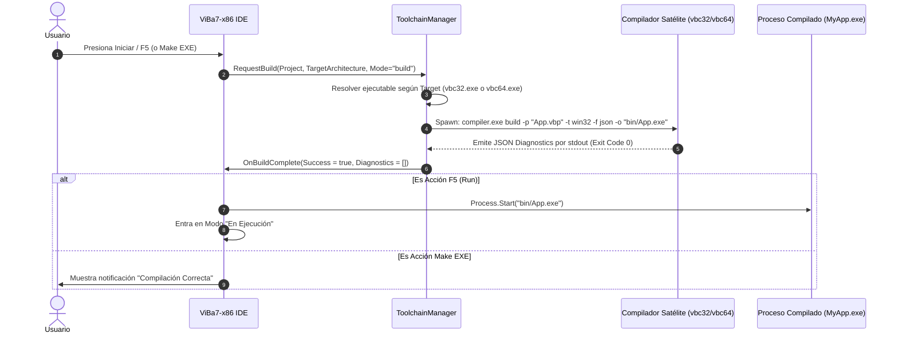

# Especificación Formal del Contrato de Compilación: Toolchain ViBa7

**Proyecto:** ViBa7-x86 IDE  
**Versión del Protocolo:** 1.0 (Bifurcación x32 / x64)  
**Fecha:** Octubre 2026  
**Estado:** Formal / Aprobado  

---

## 1. Filosofía de Arquitectura Desacoplada

El IDE **ViBa7-x86** adopta una arquitectura de frontend desacoplada inspirada en los estándares de ingeniería de compiladores modernos (como LLVM/Clang y Language Server Protocol).

El IDE **no contiene un motor interno de generación de código máquina**. En su lugar:
1. El IDE gestiona la interfaz gráfica, el modelo de proyecto (`.vbp`), el editor de código, el resaltado léxico, y el diseñador visual OLE/ActiveX nativo (en 32 bits).
2. La compilación, validación semántica pesada, optimización y emisión de binarios se delega a **compiladores satélites independientes**:
   - **`vbc32.exe` (ViBa-C32):** Compilador Win32 x86, 100% retrocompatible con VB6 SP6 y enlazado con `msvbvm60.dll`.
   - **`vbc64.exe` (ViBa-C64):** Compilador Win64 x86-64, para proyectos nuevos, enlazado con el runtime moderno `vbrunt64.dll`.
3. La comunicación se realiza mediante un contrato estricto de **línea de comandos (CLI) y emisión estructurada de diagnósticos en JSON**.

```
┌────────────────────────────────────────────────────────────────────────┐
│                        ViBa7-x86 IDE (Frontend)                        │
│             [ProjectModel] ──> [ToolchainManager Driver]               │
└───────────────────────────────────┬────────────────────────────────────┘
                                    │
               CLI Invocation + JSON Diagnostics Protocol
                                    │
        ┌───────────────────────────┴───────────────────────────┐
        ▼                                                       ▼
┌───────────────────────────────┐       ┌───────────────────────────────┐
│     vbc32.exe (ViBa-C32)      │       │     vbc64.exe (ViBa-C64)      │
│     Compilador Win32 x86      │       │     Compilador Win64 x64      │
├───────────────────────────────┤       ├───────────────────────────────┤
│ • Entrada: .vbp clásico       │       │ • Entrada: .vbp / .vbproj x64 │
│ • Salida: PE32 (i386)         │       │ • Salida: PE32+ (x86-64)      │
│ • Runtime: msvbvm60.dll       │       │ • Runtime: vbrunt64.dll       │
│ • ABI: stdcall / COM vtable   │       │ • ABI: Microsoft x64 fastcall │
│ • Tipos: VB6 SP6 Estricto     │       │ • Tipos: LongLong, LongPtr    │
└───────────────────────────────┘       └───────────────────────────────┘
```

---

## 2. Interfaz de Línea de Comandos (CLI Specification)

Ambos compiladores satélites (`vbc32` y `vbc64`) deben implementar una sintaxis de invocación CLI consistente.

### 2.1 Sintaxis General

```bash
<compiler-binary> <command> [options] <project-or-file>
```

### 2.2 Comandos Soportados

| Comando | Descripción |
| :--- | :--- |
| `build` | Realiza el análisis completo, compilación, enlace y generación del binario final. |
| `check` | Realiza análisis léxico, sintáctico y semántico (Type Checking) sin emitir archivos binarios. Emite diagnósticos estructurados. Es el comando utilizado por el IDE para validaciones en segundo plano. |
| `version` | Imprime la versión del compilador, arquitectura soportada, capacidades y ruta de runtime detectada. |
| `help` | Imprime la guía de uso y parámetros soportados. |

### 2.3 Parámetros y Opciones Comunes

| Opción | Argumento | Descripción |
| :--- | :--- | :--- |
| `--project`, `-p` | `<path>` | Ruta absoluta o relativa al archivo `.vbp` o archivo principal. |
| `--target`, `-t` | `win32` \| `win64` | Arquitectura del binario destino (debe coincidir con la naturaleza del compilador). |
| `--out`, `-o` | `<path>` | Ruta completa del archivo binario a generar (e.g. `C:\App\bin\MyApp.exe`). |
| `--mode`, `-m` | `gui` \| `console` \| `dll` \| `ocx` | Tipo de subsistema PE a generar (GUI estándar VB6, Consola Win32/Win64, DLL ActiveX, Control ActiveX). |
| `--format`, `-f` | `json` \| `text` | Formato de salida de logs y diagnósticos por `stdout`. En el IDE siempre se pasa `--format json`. |
| `--debug`, `-g` | Ninguno | Genera información de depuración simbólica (archivo `.pdb`). |
| `--optimize`, `-O` | `none` \| `speed` \| `size` | Nivel de optimización de código máquina. |
| `--define`, `-d` | `<KEY=VALUE>` | Define constantes de compilación condicional (e.g. `--define Win64=1 --define DEBUG=1`). Puede repetirse. |
| `--runtime-path` | `<path>` | Permite especificar una ruta personalizada para el runtime (`msvbvm60.dll` o `vbrunt64.dll`). |
| `--reference`, `-r`| `<path>` | Ruta adicional a TypeLib (.tlb, .olb) o componente COM (.dll, .ocx). Puede repetirse. |
| `--verbose`, `-v` | Ninguno | Habilita detalles adicionales de telemetría de fases de compilación. |

---

## 3. Esquema del Protocolo de Diagnósticos (JSON Output Schema)

Cuando se especifica `--format json`, el compilador **debe emitir un único objeto JSON consolidado en `stdout`** al terminar la ejecución (o líneas individuales en formato NDJSON si se trata de compilación interactiva).

### 3.1 Esquema JSON (Respuesta de Compilación)

```json
{
  "$schema": "https://json-schema.org/draft/2020-12/schema",
  "title": "ViBaCompilerOutput",
  "type": "object",
  "required": ["protocolVersion", "compiler", "command", "target", "status", "exitCode", "durationMs", "diagnostics"],
  "properties": {
    "protocolVersion": { "type": "string", "enum": ["1.0"] },
    "compiler": {
      "type": "object",
      "required": ["name", "version", "architecture"],
      "properties": {
        "name": { "type": "string" },
        "version": { "type": "string" },
        "architecture": { "type": "string", "enum": ["x86", "x64"] }
      }
    },
    "command": { "type": "string", "enum": ["build", "check"] },
    "target": { "type": "string", "enum": ["win32", "win64"] },
    "status": { "type": "string", "enum": ["success", "warning", "error"] },
    "exitCode": { "type": "integer" },
    "durationMs": { "type": "integer" },
    "outputBinary": { "type": ["string", "null"] },
    "outputPdb": { "type": ["string", "null"] },
    "diagnostics": {
      "type": "array",
      "items": {
        "type": "object",
        "required": ["id", "severity", "file", "line", "column", "message"],
        "properties": {
          "id": { "type": "string" },
          "severity": { "type": "string", "enum": ["error", "warning", "info"] },
          "file": { "type": "string" },
          "line": { "type": "integer" },
          "column": { "type": "integer" },
          "endLine": { "type": "integer" },
          "endColumn": { "type": "integer" },
          "message": { "type": "string" },
          "snippet": { "type": "string" }
        }
      }
    },
    "statistics": {
      "type": "object",
      "properties": {
        "filesCompiled": { "type": "integer" },
        "totalLines": { "type": "integer" },
        "codeSizeBytes": { "type": "integer" },
        "dataSizeBytes": { "type": "integer" }
      }
    }
  }
}
```

### 3.2 Códigos de Salida del Proceso (Exit Codes)

| Código | Significado | Acción del IDE |
| :---: | :--- | :--- |
| **`0`** | **Éxito (Success)**: No se encontraron errores de compilación. Si se ejecutó `build`, el binario está listo en disco. | Limpia la lista de errores, reporta éxito y, si se pulsó F5, lanza el ejecutable. |
| **`1`** | **Error de Código (Build Failure)**: Uno o más errores léxicos, sintácticos o de tipos. | Mapea la lista `diagnostics` en la ventana "Lista de Errores" del IDE y sitúa el cursor en el primer error. |
| **`2`** | **Error de Entrada/Salida**: Archivo `.vbp`, módulo o TypeLib faltante o inaccesible. | Notifica mediante cuadro de diálogo de recursos faltantes. |
| **`3`** | **Error de Parámetros**: Argumentos CLI inválidos o incompatibles. | Registra error interno en el log del IDE. |
| **`10`** | **Fallo Interno del Compilador (ICE)**: Excepción no controlada en el compilador. | Muestra cuadro de reporte de fallo del compilador con el volcado técnico. |

---

## 4. Especificación del Compilador Satélite x32 (`vbc32.exe`)

El compilador de 32 bits tiene como misión **la retrocompatibilidad absoluta al 100% con Microsoft Visual Basic 6.0 Service Pack 6**.

### 4.1 Formato Binario PE32 (i386)
* Formato: Windows Portable Executable 32-bit (`IMAGE_FILE_MACHINE_I386` = `0x014C`).
* Subsystem: `IMAGE_SUBSYSTEM_WINDOWS_GUI` (`0x0002`) o `IMAGE_SUBSYSTEM_WINDOWS_CUI` (`0x0003`).
* Flags de Cabecera: Debe incluir `IMAGE_FILE_32BIT_MACHINE` y `IMAGE_FILE_LARGE_ADDRESS_AWARE` (para acceso hasta 4 GB en sistemas x64).

### 4.2 Enlace con el Runtime `msvbvm60.dll`
* **Import Directory:** El ejecutable generado debe importar `msvbvm60.dll`.
* **Entry Point Canónico:** El punto de entrada (`AddressOfEntryPoint`) salta a `msvbvm60!ThunRTMain`.
* **Argumento a `ThunRTMain`:** En el registro `EAX` o empujado en la pila se pasa el puntero a la estructura `VBHeader`.

### 4.3 Estructuras Internas Requeridas de VB6
Para que los componentes COM, formularios y el runtime de VB6 reconozcan el ejecutable, deben emitirse las siguientes estructuras en la sección `.data` o `.rdata`:

```c
// Cabecera Principal de VB6
typedef struct _VBHeader {
    char          szMagic[4];        // "VB5!"
    WORD          wRuntimeBuild;     // Versión de build del runtime
    char          szLanguageDLL[14]; // Idioma
    char          szSecLanguageDLL[14];
    WORD          wRuntimeRevision;
    DWORD         dwLCID;
    DWORD         dwSecLCID;
    DWORD         lpSubMain;         // Puntero a Sub Main si existe
    struct _tProjectInfo* lpProjectInfo; // Descriptor del Proyecto
    DWORD         fMDWFlags;
    DWORD         fMDWFlags2;
    DWORD         dwThreadFlags;
    DWORD         dwThreadCount;
    WORD          wFormCount;
    WORD          wExternalComponentCount;
    DWORD         dwThunkCount;
    DWORD         lpGuiTable;
    DWORD         lpIdeFlag;
    DWORD         lpProjectData;
} VBHeader;
```

### 4.4 Tipos de Datos y Representación en Memoria (x86)
* `Integer`: 16 bits signed (`short`).
* `Long`: 32 bits signed (`int32_t`).
* `Single`: 32 bits IEEE 754 float.
* `Double`: 64 bits IEEE 754 float.
* `Currency`: 64 bits entero escalado fijo (`CY` = entero / 10,000).
* `Date`: 64 bits float (OLE Automation Date, días desde 30/12/1899).
* `String`: Puntero BSTR de 32 bits terminado en NULL con prefijo de longitud de 4 bytes.
* `Variant`: Estructura OLE VARIANT canónica de 16 bytes.
* `Boolean`: 16 bits (`0` = False, `-1` = True).
* `Punteros`: `VarPtr`, `StrPtr`, `ObjPtr` retornan siempre enteros de 32 bits (`DWORD`).

---

## 5. Especificación del Compilador Satélite x64 (`vbc64.exe`)

El compilador de 64 bits está destinado a **nuevos proyectos de alto rendimiento y proyectos migrados** que requieran superar la barrera de 4 GB de memoria y operar nativamente en Windows de 64 bits.

### 5.1 Formato Binario PE32+ (x86-64 / AMD64)
* Formato: Windows PE32+ (`IMAGE_FILE_MACHINE_AMD64` = `0x8664`).
* Convención de Llamadas: Convención oficial Microsoft x64 (argumentos en `RCX`, `RDX`, `R8`, `R9`, retorno en `RAX`, shadow space obligatorio de 32 bytes en la pila).

### 5.2 Runtime Nativo `vbrunt64.dll`
* No utiliza `msvbvm60.dll` (que es estrictamente de 32 bits).
* Utiliza una biblioteca dinámica nativa x64 (`vbrunt64.dll`) que provee:
  * Manipulación de arrays SafeArray x64.
  * Funciones de cadenas BSTR y variantes en 64 bits.
  * Funciones matemáticas, de conversión y tratamiento de errores (`ErrObject`).

### 5.3 Extensiones Sintácticas Obligatorias (Paridad VBA7)
El compilador x64 debe admitir la sintaxis extendida que Microsoft introdujo para VBA en Office de 64 bits:
1. **Tipo `LongPtr`:**
   * Representa un entero con el tamaño natural de un puntero (en x64 equivale a un entero de 64 bits `int64_t`).
2. **Tipo `LongLong`:**
   * Entero con signo de 64 bits real (`int64_t`), con sufijo literal `^` (e.g. `Dim largeVal As LongLong = 1000000000000^`).
3. **Modificador `PtrSafe`:**
   * Obligatorio en declaraciones de APIs de Windows:
     ```vb
     Declare PtrSafe Function SendMessage Lib "user32" Alias "SendMessageA" ( _
         ByVal hWnd As LongPtr, ByVal wMsg As Long, _
         ByVal wParam As LongPtr, ByVal lParam As LongPtr) As LongPtr
     ```
4. **Constantes de Compilación Condicional Predefinidas:**
   * `#If Win64 Then` -> Evaluado a `True`.
   * `#If VBA7 Then` -> Evaluado a `True`.
   * `#If ViBa Then` -> Evaluado a `True`.

---

## 6. Módulo Conector en el IDE: `ToolchainManager`

El IDE **ViBa7-x86** implementa un driver orquestador que gestiona la invocación y el ciclo de vida del compilador.

### 6.1 Diagrama de Secuencia de Compilación y Ejecución (F5)



### 6.2 Detección y Fallback de Compiladores en el IDE

En las opciones de configuración del IDE (`Opciones -> Compiladores`), el usuario puede configurar:
1. **Ruta al Compilador x32:**
   * Valor por defecto: `%APP_DIR%\tools\vbc32\vbc32.exe`.
   * Opción de Fallback Clásico: Si el usuario dispone de una instalación legítima de Visual Basic 6.0, el IDE puede ofrecer opcionalmente la ruta a `VB6.EXE` para compilar mediante el flag oficial `VB6.EXE /make "Proyecto.vbp" /outdir "bin"`.
2. **Ruta al Compilador x64:**
   * Valor por defecto: `%APP_DIR%\tools\vbc64\vbc64.exe`.

---

## 7. Criterios de Validación y Certificación del Toolchain

Para considerar que un compilador satélite cumple formalmente con esta especificación:

1. **Test de Emisión CLI y JSON:**
   * Debe responder al comando `vbc --version` y `vbc check -p fixture.vbp -f json` devolviendo un JSON estrictamente válido conforme al esquema de la sección 3.1.
2. **Test de Ejecución de Binario PE32 (x32):**
   * El binario generado por `vbc32.exe` debe ejecutar limpiamente en una máquina limpia con Windows 10/11 sin requerir dependencias adicionales a las de `msvbvm60.dll`.
3. **Test de Ejecución de Binario PE64 (x64):**
   * El binario generado por `vbc64.exe` debe ejecutar en Windows x64 haciendo uso de la convención de llamadas x64 y superando llamadas de API de 64 bits con `PtrSafe`.
